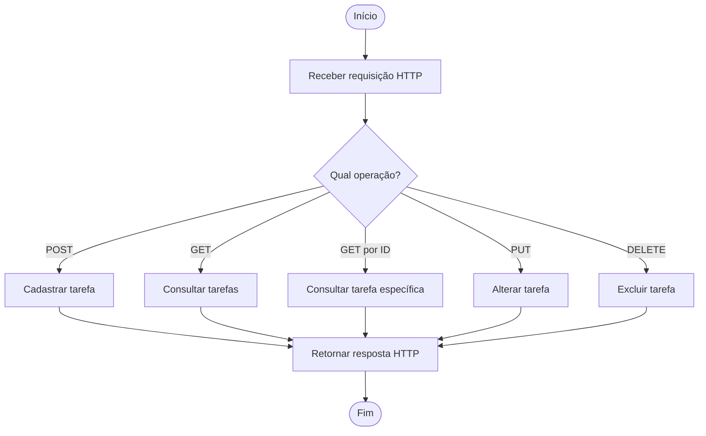

# TaskControl API

## 1. Nome do Projeto

**TaskControl API – Sistema de Controle de Tarefas.**

## 2. Resumo

O TaskControl API é um projeto desenvolvido em Python utilizando Flask. Seu objetivo é permitir o gerenciamento de tarefas por meio de requisições HTTP. A aplicação permite cadastrar, consultar, alterar e excluir tarefas de maneira simples.

## 3. Módulos

O projeto possui cinco módulos:

1. Cadastro de tarefas (POST).
2. Consulta de tarefas (GET).
3. Consulta de uma tarefa específica (GET por ID).
4. Alteração de tarefas (PUT).
5. Exclusão de tarefas (DELETE).

## 4. Descrição dos Módulos

- **Cadastro de tarefas:** permite adicionar uma nova tarefa informando título e descrição.
- **Consulta de tarefas:** apresenta todas as tarefas cadastradas.
- **Consulta individual:** permite localizar uma tarefa utilizando seu ID.
- **Alteração de tarefas:** permite modificar o título, a descrição e o status de uma tarefa.
- **Exclusão de tarefas:** permite remover uma tarefa pelo seu ID.

## 5. Fluxograma da Aplicação

O fluxo da aplicação começa com o recebimento de uma requisição. A API identifica a operação solicitada e executa a função correspondente.

## 6
